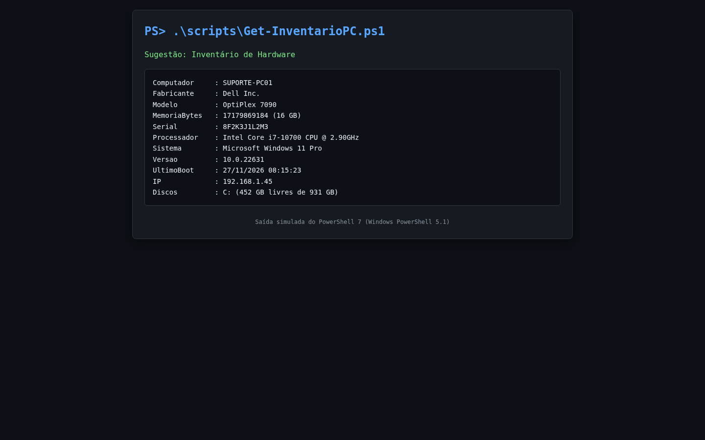
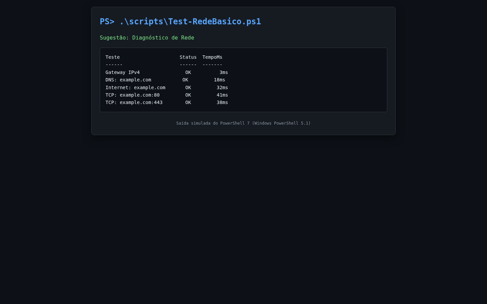
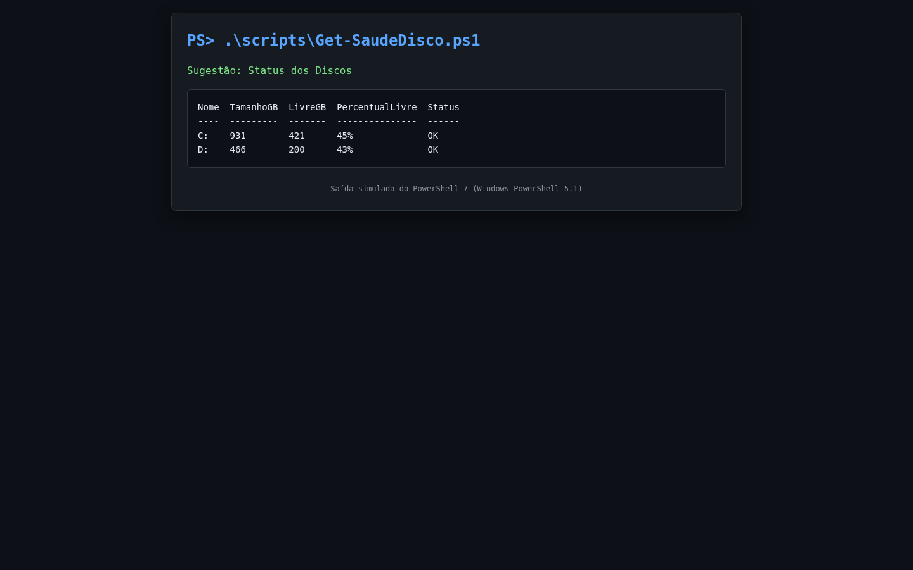
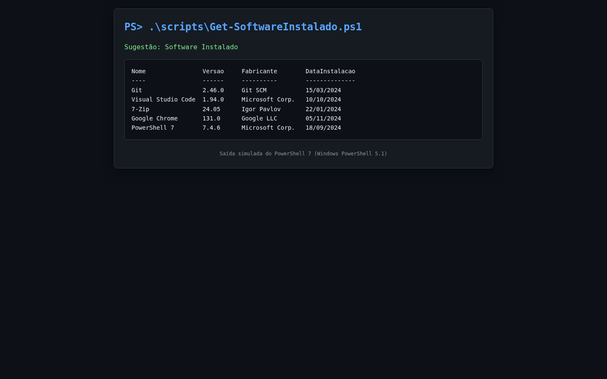
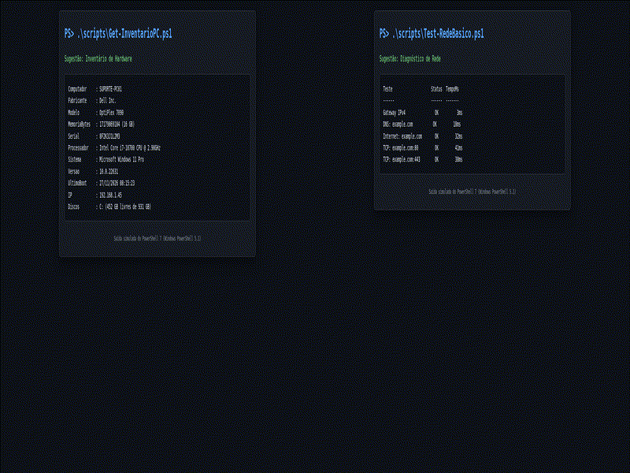

# Demonstração do Kit de Suporte PowerShell

## Prints PNG

Os prints abaixo mostram as telas dos scripts principais em execução.

### Get-InventarioPC.ps1 - Inventário de Hardware

Coleta informações detalhadas do hardware: computador, BIOS, processador, memória, sistema operacional, IPs e discos.

### Test-RedeBasico.ps1 - Diagnóstico de Rede

Verifica gateway, DNS, conectividade com internet e portas TCP específicas.

### Get-SaudeDisco.ps1 - Status dos Discos

Mostra uso de disco, espaço livre e classifica o status (OK, ALERTA, CRITICO).

### Get-SoftwareInstalado.ps1 - Software Instalado

Lista o software instalado via registro do Windows, exportável para CSV.

## GIF de Demonstração

O arquivo `demo-terminal.gif` mostra a simulação da execução dos scripts principais em sequência (PowerShell no terminal).

### Demo interativa

Para uma experiência mais interativa, acesse `demo-terminal.html` que mostra a saída dos scripts com formatação adequada.